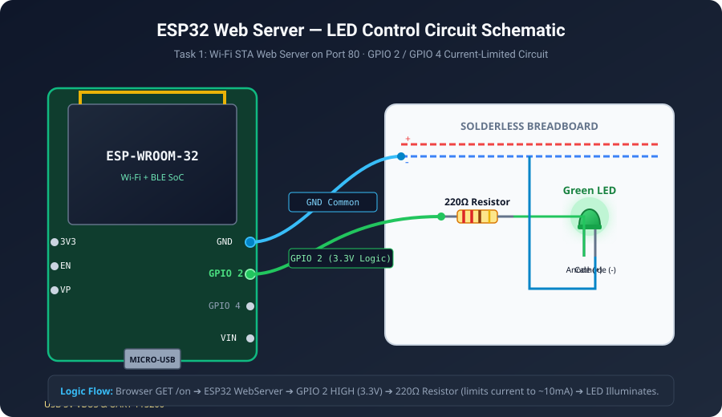
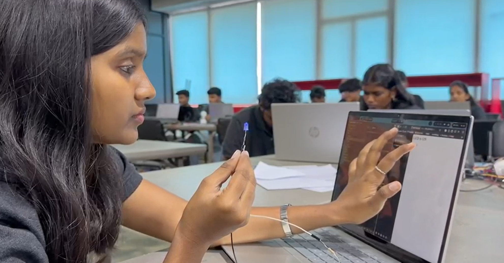
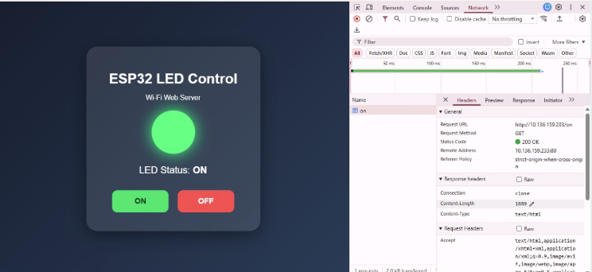
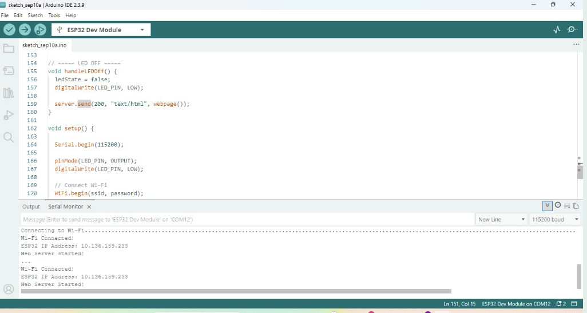

# 🌐 ESP32 Web Server LED Control

### Task 1 | IoT & Connectivity

[](https://www.espressif.com/)
[](https://www.arduino.cc/)
[](https://en.wikipedia.org/wiki/Hypertext_Transfer_Protocol)
[](#)

---

## 📌 Project Overview

This project demonstrates the configuration of an **ESP32 microcontroller** as a standalone **HTTP Web Server** in **Station (STA) mode**. Users connected to the same local Wi-Fi network can navigate to the ESP32's assigned private IP address (`10.136.159.233`) in any desktop or mobile browser to control an LED wirelessly in real time.

The system serves a responsive, dark-themed HTML/CSS graphical interface featuring interactive **TURN ON** and **TURN OFF** buttons. When a user presses a button, the browser issues an `HTTP GET` request (`/on` or `/off`), which the ESP32 parses to toggle the corresponding GPIO pin (`GPIO 2` / `GPIO 4`), driving the LED through a 220Ω current-limiting resistor while returning HTTP status code `200 OK`.

---

## 🎯 Objectives

- Configure the ESP32 Wi-Fi subsystem in **Station (STA)** mode to associate with a local 2.4 GHz Access Point.
- Implement an embedded **HTTP Web Server** listening on standard TCP Port 80 using the `<WebServer.h>` library.
- Design and serve an inline responsive HTML5 and CSS3 dashboard with real-time visual state feedback.
- Map browser HTTP requests (`/`, `/on`, `/off`, `/status`) to microcontroller hardware routines.
- Understand client-server communication, stateless request-response mechanics, and non-blocking polling loops (`server.handleClient()`).
- Document the end-to-end system with hardware photographs, serial diagnostics, network packet inspections, and video demonstrations.

---

## 🛠️ Components Required

### Hardware Components
| Component | Specification / Value | Quantity | Purpose |
| :--- | :--- | :---: | :--- |
| **ESP32 Dev Module** | ESP-WROOM-32 (30-pin / 38-pin), 2.4 GHz Wi-Fi + BLE | 1 | Microcontroller host & web server |
| **LED** | 5mm Standard Through-Hole (Green / Red), $V_f \approx 2.0\text{V}$ | 1 | Output indicator actuator |
| **Current Limiting Resistor** | 220 Ω ($\pm 5\%$, 1/4W) | 1 | Limits current to $\approx 10\text{mA}$ to protect GPIO |
| **Solderless Breadboard** | 400 tie-points | 1 | Prototyping platform |
| **Jumper Wires** | Male-to-Male (Dupont) | 3 | Circuit interconnection |
| **Micro-USB Cable** | Data & Power Rated | 1 | 5V DC power & UART serial flashing |
| **Development PC** | Windows 11 / macOS / Linux | 1 | IDE flashing & client browser control |

### Software & Libraries
- **Arduino IDE 2.3.x** with the official ESP32 Board Support Package (`esp32` by Espressif Systems).
- `<WiFi.h>` (built-in ESP32 core library for 802.11 b/g/n station networking).
- `<WebServer.h>` (lightweight embedded HTTP daemon for request routing and response handling).
- Any modern web browser (Google Chrome, Mozilla Firefox, Microsoft Edge, Safari).

---

## 💻 Technologies Used

- **Embedded C++** (Arduino Framework)
- **ESP32 Wi-Fi Architecture** (Station Mode `WIFI_STA`)
- **HTTP / 1.1 Protocol** (TCP Port 80, GET method, Status Codes 200, 303, 404)
- **HTML5 & CSS3** (Inline responsive dark-theme UI with CSS flexbox and glow effects)
- **UART Serial Diagnostics** (115200 baud rate)

---

## ⚙️ How It Works

```
+-----------------------------------------------------------------------------------+
|                            CLIENT - SERVER ARCHITECTURE                           |
+-----------------------------------------------------------------------------------+
|                                                                                   |
|  [ Client Web Browser ]                                                           |
|       |                                                                           |
|       | 1. HTTP GET /on  (User clicks "TURN ON" button)                           |
|       v                                                                           |
|  [ Local 2.4 GHz Wi-Fi Router / AP ]                                              |
|       |                                                                           |
|       | 2. TCP Packet routed to 10.136.159.233:80                                 |
|       v                                                                           |
|  [ ESP32 Web Server (WebServer server(80)) ]                                      |
|       |                                                                           |
|       | 3. server.handleClient() detects incoming route "/on"                     |
|       | 4. Executes handleLEDOn():                                                |
|       |       - digitalWrite(LED_PIN, HIGH);  --> 3.3V out on GPIO 2             |
|       |       - ledState = true;                                                  |
|       | 5. Generates updated HTML page with glowing indicator                     |
|       v                                                                           |
|  [ HTTP 200 OK Response ] -----------------------------------------> [ Browser ]  |
|                                                                                   |
|  [ Physical Actuation ]                                                           |
|       GPIO 2 (3.3V) ---> [ 220Ω Resistor ] ---> [ LED Anode (+) ]                 |
|                                                      |                            |
|       ESP32 GND (0V) <-------------------------- [ LED Cathode (-) ]              |
|                                                                                   |
+-----------------------------------------------------------------------------------+
```

### Detailed Sequence:
1. **Network Association**: On boot, the ESP32 connects to the specified Wi-Fi SSID in `WIFI_STA` mode.
2. **IP Assignment**: The DHCP server assigns an internal IP (e.g., `10.136.159.233`), printed to the Serial Monitor.
3. **Route Registration**: 
   - `GET /` $\rightarrow$ `handleRoot()`: Returns the homepage dashboard.
   - `GET /on` $\rightarrow$ `handleLEDOn()`: Sets `digitalWrite(LED_PIN, HIGH)` and returns updated dashboard.
   - `GET /off` $\rightarrow$ `handleLEDOff()`: Sets `digitalWrite(LED_PIN, LOW)` and returns updated dashboard.
   - `GET /status` $\rightarrow$ `handleStatus()`: Returns JSON payload `{"status": "ON", "gpio": 2, "ip": "10.136.159.233"}`.
4. **Non-Blocking Loop**: `loop()` executes `server.handleClient()` continuously to service incoming connections.

---

## 🔌 Circuit Diagram & Pin Connections

### Pin Connection Table
| ESP32 Pin | Component Pin | Wire Color | Function / Electrical Logic |
| :--- | :--- | :---: | :--- |
| **GPIO 2** (or 4) | 220 Ω Resistor Lead 1 | 🟢 Green | Digital Output (3.3V logic level, active HIGH) |
| *Resistor Lead 2* | LED Anode (+ longer lead) | 🟢 Green | Current-limited 3.3V forward current ($\approx 10\text{mA}$) |
| **GND** | LED Cathode (- shorter lead / flat rim) | 🔵 Blue | Common circuit ground return (0V reference) |
| **Micro-USB** | PC USB Port (5V VBUS) | ⬛ Black | 5V Regulated supply and 115200 baud UART logging |

### Circuit Schematic


---

## 📂 Project Structure

```
ESP32-Web-Server-LED-Control/
├── README.md                           # Main repository documentation
├── src/
│   └── esp32_webserver_led.ino         # Complete Arduino source code
├── screenshots/
│   ├── README.md                       # Description of visual assets
│   ├── task1-circuit-diagram.svg       # Vector wiring schematic diagram
│   ├── task1-photo1.png                # Physical hardware workstation & setup
│   ├── task1-photo2.png                # Web interface & DevTools Network 200 OK
│   └── task1-photo3.png                # Arduino IDE 2.3.x & Serial Monitor log
└── media/
    └── task1-video.mp4                 # Full physical demonstration video
```

---

## 📸 Project Screenshots

### 1. Physical Hardware Setup & Prototyping
Archana C testing the ESP32 DevKit and breadboard circuit connected to the laptop serial workstation:


### 2. Web Browser Control Interface & Network Inspection
Responsive browser dashboard displaying LED status ON with Chrome DevTools inspecting the `HTTP GET /on` request returning HTTP status `200 OK`:


### 3. Arduino IDE Compilation & Serial Monitor Diagnostics
Arduino IDE 2.3.x showing sketch compilation, upload to ESP32, and live Serial Monitor log at 115200 baud showing Wi-Fi station association, assigned IP `10.136.159.233`, and web server initialization:


---

## 🎬 Demonstration Video

The full working video demonstration showing wireless LED ON/OFF control with real-time browser toggling is available in the [`media/`](media/) directory:

▶️ **Watch the Demo Video:** [`media/task1-video.mp4`](media/task1-video.mp4)

*The demonstration verifies immediate LED state transitions with sub-second latency across the local Wi-Fi network.*

---

## 🚀 How to Run

### Step 1: Hardware Setup
1. Mount the ESP32 onto the breadboard.
2. Insert a 220Ω resistor between **GPIO 2** (or GPIO 4) and a vacant breadboard row.
3. Insert the **Anode** (longer leg) of the LED into the same row as the resistor.
4. Insert the **Cathode** (shorter leg) into the Ground rail.
5. Connect the ESP32 **GND** pin to the Ground rail.
6. Connect the ESP32 to your PC using a micro-USB data cable.

### Step 2: Software Setup
1. Launch **Arduino IDE** (version 2.0 or newer).
2. Install ESP32 board support via **Boards Manager** (`esp32` by Espressif Systems).
3. Select your board under **Tools > Board > ESP32 Arduino > ESP32 Dev Module**.
4. Select the correct COM port under **Tools > Port**.

### Step 3: Configure Credentials & Upload
1. Open [`src/esp32_webserver_led.ino`](src/esp32_webserver_led.ino).
2. Update the network credentials:
   ```cpp
   const char* ssid     = "YOUR_2.4GHZ_WIFI_SSID";
   const char* password = "YOUR_WIFI_PASSWORD";
   ```
3. Click **Upload** (Ctrl + U). Hold the `BOOT` button on the ESP32 if the serial bootloader fails to sync automatically.

### Step 4: Access Web Server
1. Open the **Serial Monitor** (Ctrl + Shift + M) at **115200 baud**.
2. Note the printed IP address:
   ```
   Wi-Fi Connected!
   ESP32 IP Address: 10.136.159.233
   Web Server Started! Listening on port 80.
   ```
3. Open any web browser on a device connected to the **same Wi-Fi network**.
4. Navigate to `http://10.136.159.233/` and click **ON** or **OFF** to control the LED!

---

## 🛠️ Problems Encountered & Technical Solutions

| Problem Faced | Root Cause | Implemented Solution |
| :--- | :--- | :--- |
| **Wi-Fi Connection Timeout (`...`)** | Attempting to connect to a 5 GHz Wi-Fi SSID unsupported by the ESP32 802.11 b/g/n hardware radio. | Configured router to broadcast a dedicated 2.4 GHz SSID and connected ESP32 exclusively to it. |
| **Browser `ERR_CONNECTION_TIMED_OUT`** | Laptop and ESP32 were connected to different subnets (laptop on mobile hotspot, ESP32 on campus network). | Connected both devices to the same Access Point and verified ICMP reachability (`ping 10.136.159.233`). |
| **LED Inactive Despite Serial Logs** | LED inserted with reversed polarity, or GPIO pin floating without pull-down. | Verified LED Anode connects to 220Ω resistor and Cathode to GND. Explicitly set `pinMode(LED_PIN, OUTPUT)`. |
| **Port 80 Access Blocked on iOS/Chrome** | Browser auto-redirecting to `https://` (port 443) instead of `http://` (port 80). | Explicitly typed `http://10.136.159.233` with the `http://` scheme to avoid HSTS auto-upgrade. |

---

## 💡 Learning Reflection

Implementing an embedded HTTP web server on the ESP32 provided invaluable hands-on understanding of microcontroller networking. Key takeaways:
1. **Microcontroller as a Network Host**: Rather than viewing microcontrollers as simple sequential sensor readers, I experienced how lightweight RTOS stacks enable them to act as full-fledged network servers handling simultaneous TCP/IP connections.
2. **Stateless HTTP Architecture**: Learned how REST-style endpoints (`GET /on`, `GET /off`) translate browser user interactions into physical hardware actuations without requiring heavy third-party broker dependencies.
3. **Foundation for Advanced IoT**: Mastering local IP routing and embedded HTML generation formed the essential technical foundation for the subsequent cloud-based MQTT (Task 2), IFTTT automation (Task 3), and Firebase Realtime Database (Task 4 & Task 5) projects in this IoT portfolio.

---

## 🔒 Security Best Practices

- **Never Commit Credentials**: Replace real Wi-Fi SSIDs and passwords with placeholders (`YOUR_WIFI_SSID`, `YOUR_WIFI_PASSWORD`) before pushing to public repositories.
- **Local Network Isolation**: Keep the ESP32 web server inside a trusted local subnet; do not forward Port 80 to the public WAN without authentication tokens.

---

## 👩‍💻 Author

**Archana C**  
Department of Electronics and Communication Engineering  
Kumaraguru College of Technology (KCT)  

- 🔗 **GitHub Profile**: [@archin123](https://github.com/archin123)
- 🌐 **Live Portfolio**: [archin123.github.io/portfolio](https://archin123.github.io/portfolio/)
- 📁 **Week 7 Task 1 Report**: [week7-task1.html](https://archin123.github.io/portfolio/week7-task1.html)
- 📦 **Standalone Repo**: [ESP32-Web-Server-LED-Control](https://github.com/archin123/ESP32-Web-Server-LED-Control)
